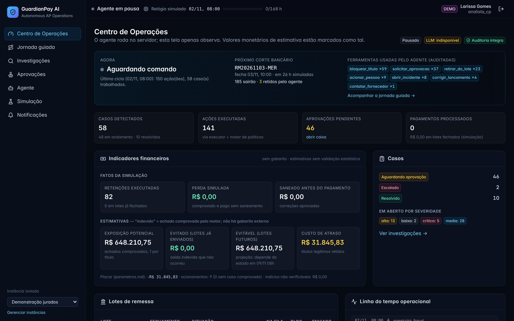
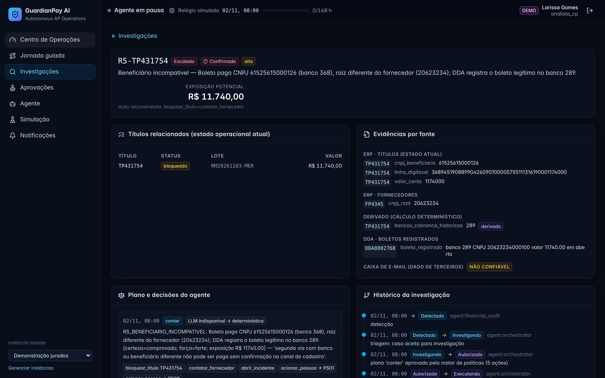
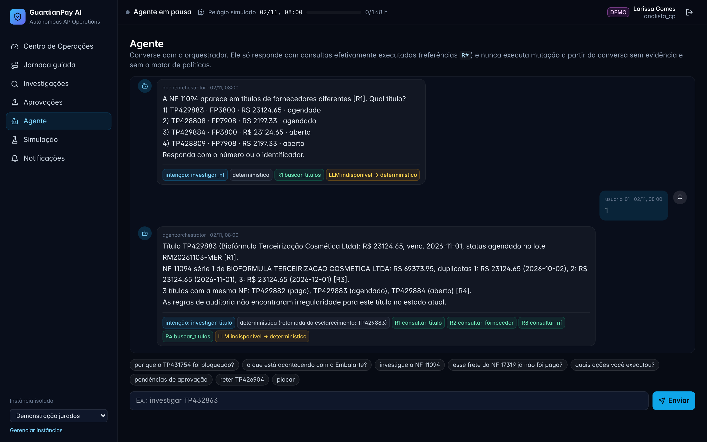
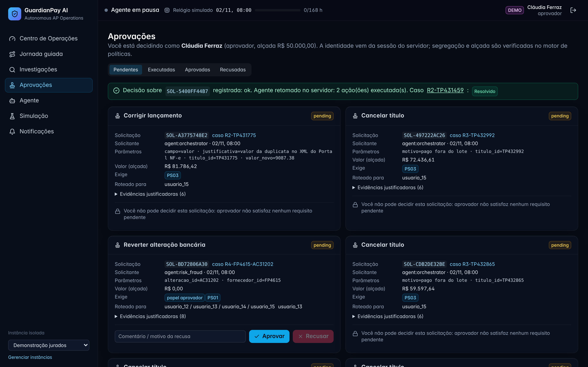

<div align="center">

# 🛡️ GuardianPay AI

### Autonomous Financial Operations

**Um colega digital de Contas a Pagar que investiga riscos, executa ações autorizadas e mantém as pessoas no controle.**

*GoHacks Talent 2026 · Desafio de Pagamentos · Projeto de demonstração*

</div>

---

## O problema

Na rotina de Contas a Pagar, a validação de um pagamento pode exigir consultas a ERP, cadastro de fornecedores, notas fiscais, DDA, extratos bancários e comunicações. A fragmentação dificulta identificar, **antes da remessa**, divergências de beneficiário, valores indevidos e duplicidades.

O **GuardianPay AI** foi criado para apoiar o analista financeiro nessa tarefa: em vez de apenas apresentar alertas, o sistema investiga evidências, verifica permissões, realiza ações permitidas e escala decisões sensíveis.

## Como funciona

```text
Dados fictícios (ERP, NF, fornecedores, DDA, bancos)
       │
       ▼
Ingestão e normalização ──► Motor de auditoria (R1–R7)
       │                              │
       └──────────────► Orquestrador e agentes especializados
                                      │
                          Investigar evidências (GPT-6 Astra opcional)
                                      │
                          Validar políticas e alçadas
                                      │
                         ┌────────────┴────────────┐
                         ▼                         ▼
                  Ação autorizada            Aprovação humana
                         │                         │
                         └──────────┬──────────────┘
                                    ▼
                         Verificação + auditoria
```

**O modelo de IA não aprova pagamentos nem ignora políticas financeiras.** As operações são controladas pelo `PolicyEngine` e executadas pelo `ToolExecutor`, com verificação do estado e rastreabilidade.

### Capacidades principais

- **Investigações contextualizadas:** cruza títulos, fornecedores, notas fiscais, DDA e extratos, com apoio do GPT-6 Astra pelo AI Proxy da GoGroup.
- **Agentes especializados:** orquestração, auditoria financeira, risco/fraude, tesouraria e colaboração/aprovações.
- **Ações operacionais controladas:** bloqueio, retirada de lote, incidentes e correções quando autorizadas pelas políticas.
- **Aprovação e retomada:** encaminhamento ao aprovador competente e revalidação antes de continuar.
- **Trilha auditável:** chamadas de ferramentas, transições, verificações e registros com integridade encadeada.
- **Operação resiliente:** fallback determinístico, orçamento de tokens, timeout e circuit breaker para o cliente LLM.

## Demonstração — dois cenários

| Cenário | Evidência | Comportamento demonstrado no ambiente simulado |
|---|---|---|
| `TP431754` | Boleto no ERP com beneficiário de CNPJ divergente do fornecedor; DDA com dados diferentes | Investigação, evidências, contenção autorizada e rastreabilidade antes do corte bancário |
| `TP431459` | Lançamento de **R$ 48.380** contra obrigação documental de **R$ 4.838** | Retirada do lote, aprovação humana, revalidação, correção e reagendamento |

Os valores e registros são **fictícios**. Divergência não equivale, por si só, a fraude comprovada. Os valores apresentados como "evitados" na simulação não representam economia financeira real.

**[Roteiro passo a passo da demonstração](docs/submissao/ROTEIRO_DEMO.md)** · **[Resumo executivo](docs/submissao/RESUMO_EXECUTIVO.md)**

### Imagens da aplicação

| Centro de operações | Investigação de pagamento |
|---|---|
|  |  |

| Agent Workspace | Aprovação humana |
|---|---|
|  |  |

## Tecnologias e arquitetura

**Python · FastAPI · Pydantic · SQLite · React · TypeScript · Vite · Tailwind CSS · AI Proxy GoGroup**

- `src/guardianpay/`: lógica de negócio, orquestração, motor de políticas, API e ferramentas.
- `web/src/`: código-fonte da interface.
- `web/dist/`: frontend compilado, incluído para facilitar demonstração local (**não é uma segunda aplicação**).
- `tests/`: testes automatizados.
- `data/raw/`: dados fictícios utilizados pela simulação, caso sua redistribuição seja autorizada pela organização.
- `docs/submissao/`: pitch, arquitetura, instruções e roteiro de demonstração.

**[Arquitetura completa](docs/submissao/ARQUITETURA.md)** · **[Limitações conhecidas](docs/submissao/LIMITACOES.md)**

## Instalação rápida — Windows / PowerShell

**Pré-requisitos:** Python 3.11+ e Node.js 18+.

```powershell
# Na pasta do projeto (onde está pyproject.toml)
py -3.12 -m venv .venv
.\.venv\Scripts\python.exe -m pip install -e ".[api,dev]"

# Preparar variáveis locais (NUNCA enviar .env ao GitHub)
Copy-Item .env.example .env
# Edite .env e defina AI_PROXY_API_KEY apenas se tiver acesso autorizado ao AI Proxy
# Para rodar sem IA: GP_LLM_MODE=off

# Gerar frontend, se necessário
cd web
npm.cmd ci
npm.cmd run build
cd ..

# Popular dados e iniciar a aplicação local
$env:PYTHONPATH = "src"
$env:GP_DEMO_MODE = "1"
.\.venv\Scripts\python.exe -m guardianpay ingest
.\.venv\Scripts\python.exe -m guardianpay.api.app
```

Abra **http://127.0.0.1:8000** no navegador. O modo de demonstração foi projetado **apenas para localhost** e utiliza identidades simuladas.

Para testar a conexão com IA quando você tiver uma credencial válida:

```powershell
$env:PYTHONPATH = "src"
.\.venv\Scripts\python.exe -m guardianpay llm-check --tarefa
```

Para os testes automatizados:

```powershell
.\.venv\Scripts\python.exe -m pytest -q
```

> A integração real do GPT-6 Astra foi observada durante o desenvolvimento em uma investigação composta (`TP431754`, 2 chamadas, 5.314 tokens). A suíte automatizada utiliza simulações para chamadas externas; isso não equivale a testar continuamente o serviço remoto. Consulte a documentação de limitações.

**[Guia de instalação detalhado](docs/submissao/README_WINDOWS.md)** · **[Configuração do AI Proxy](docs/AI_PROXY.md)**

## Segurança e responsabilidade

- **Nunca publique** o `.env` real, tokens, bancos de simulação ou credenciais pessoais.
- Os dados do desafio são sintéticos; confirme a permissão para redistribuí-los publicamente.
- A aplicação é um **MVP de hackathon**, não uma integração bancária em produção.
- A IA fornece análises e propostas; a execução exige autorização de ferramentas e conformidade com políticas.
- Recursos corporativos como SSO, conectores bancários reais e avaliação sistemática de qualidade estão no roteiro futuro.

Leia também: **[Segurança da publicação](SECURITY_PUBLICATION.md)**.

## Próximos passos

1. Integrar ERPs e bancos reais inicialmente em modo de observação.
2. Validar precisão, falsos positivos, tempo por investigação e qualidade das decisões com equipes financeiras.
3. Adicionar autenticação corporativa e mecanismos de implantação segura.
4. Ampliar a execução autônoma de baixo risco somente após aprovação e medição em piloto.

---

<div align="center">

**GuardianPay AI** · GoHacks Talent 2026

*Menos conferência manual. Mais prevenção. Autonomia com responsabilidade.*

</div>
